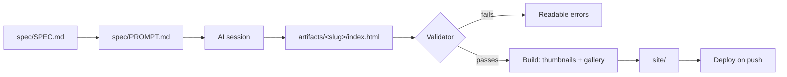
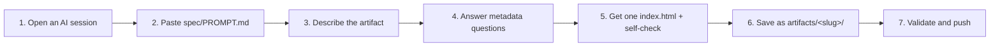

<div align="center">

# 📚 Shelf

**A personal shelf for small HTML apps, tools, and presentations.**
Kept in one repo, checked against a spec, and published as a gallery I can open by link from anywhere.


</div>

> **Status:** Working and deployable. The spec, validator, build script, gallery and Pages workflow are implemented. It ships with three sample artifacts; replace them with real ones.

---

## 😩 The problem

I make a lot of small things with AI tools: a one-page calculator, a throwaway game, a slide deck for a talk. Each one is a single HTML file that comes out of a chat window. Then it gets thrown away, or it ends up in a downloads folder, a chat history, or some tool's own preview pane. A few weeks later I can't find it, and if I need it on another machine I'm out of luck.

What I want is simple: every artifact in one place, in a consistent shape, reachable by a link.

## 🧭 What Shelf is (and isn't)

Shelf is a personal artifact host and gallery. It keeps my artifacts in one repository, validates each one against a small spec, generates a gallery site with thumbnails, and deploys it as static pages. A push is a deploy.

It is just for me. It is shown on GitHub and on my portfolio site as a proof of concept that this can be built.

| Shelf is | Shelf is not |
| --- | --- |
| A personal tool for one person | A platform |
| A repo of static files | A service with accounts |
| Plain pages served from static hosting | Cloud storage for user data |
| Checked by a validator | Moderated, because I am the only author |

## ⚙️ How it works

Shelf has five pieces:

| # | Piece | What it does |
| --- | --- | --- |
| 1 | **Spec** | The rules an artifact must follow. |
| 2 | **Paste-in prompt** | The spec written as a prompt I give any AI session, so new artifacts come out conformant. |
| 3 | **Validator** | A CLI that checks each artifact against the spec and fails with readable errors. |
| 4 | **Build script** | Validates, takes a screenshot of each artifact for a thumbnail, and generates the gallery. |
| 5 | **Deploy** | Publishes the generated site as static pages on a subdomain of my portfolio. |



The validator, build script and gallery are implemented. See [Getting started](#-getting-started).

## 📐 The spec in brief

The full text is in [`spec/SPEC.md`](spec/SPEC.md). In short, an artifact:

- 📁 is a folder `artifacts/<slug>/` with an `index.html` entry point, ideally one self-contained file;
- 📌 has no build step, and loads external scripts only from CDNs with an exact pinned version;
- 🏷️ carries a JSON metadata block in its head (fields are in [`spec/METADATA.md`](spec/METADATA.md));
- 🔒 stores nothing and makes no network requests unless its metadata says so;
- 🔑 contains no API keys, tokens, or personal data;
- 📱 has a `lang` attribute, a viewport meta tag, a title, and a layout that works at phone width;
- 🎞️ if it is a presentation, supports arrow keys and space, `F` for fullscreen, and prints one slide per page;
- 🚧 can be marked `draft: true` to keep it out of the build and the public site.

## 📋 The paste-in prompt workflow



The prompt is in [`spec/PROMPT.md`](spec/PROMPT.md). The session asks me for any metadata it is missing instead of guessing.

## 🗂️ Repository structure

```text
shelf/
├── artifacts/   One folder per artifact: artifacts/<slug>/index.html
├── spec/        The spec, the metadata reference, and the paste-in prompt
├── gallery/     The gallery UI (Vite, React, Tailwind, shadcn/ui)
├── tools/
│   ├── validate/   The validator and its tests
│   └── build/      The build script, thumbnails and tests
├── site/        Generated output (git-ignored, built by CI)
├── docs/        Architecture, decisions, deployment, security, roadmap
└── .github/     The validate, build and deploy workflow
```

## 🧰 Tech

| Area | Choice |
| --- | --- |
| Validator and build script | Python 3.9+, standard library only |
| Gallery UI | React, Tailwind CSS v4, shadcn/ui, built with Vite |
| Thumbnails | Playwright (best effort) |
| Hosting | GitHub Pages, from `main`; any static host works |

Decisions are logged in [`docs/decisions.md`](docs/decisions.md).

## 🔐 Security and privacy

The repo and the site are public, so I treat everything in them as public.

- 🚧 **Draft flag:** `draft: true` keeps an artifact out of the build and the site. It is still in the repo, so drafts are not private.
- 🔎 **Secret scan:** the validator scans every file for credentials and email addresses and fails the build.
- 📦 **Sandboxed embeds:** artifacts embedded in my portfolio site should go in an iframe with the `sandbox` attribute, so a buggy artifact can't affect the host page.
- 🫥 **Ephemeral by default:** artifacts keep no data and send nothing to a server unless their metadata declares it.

More in [`docs/security.md`](docs/security.md).

## 🎤 The use case

> I'm at a conference and I'm handed a room machine I've never used. My slides are an HTML presentation I made weeks ago. I don't want to sign in to anything or plug in a drive. I open a browser, go to the Shelf address, tap the presentation, and press `F`. Arrow keys move through the slides. The same link works from my phone if the room machine fails.

## 🗺️ Roadmap

- [x] Spec v0
- [x] Validator
- [x] Build script and thumbnails
- [x] Gallery and deploy workflow
- [ ] Turn on GitHub Pages
- [ ] First 8-12 curated artifacts, each with a short note
- [ ] Optional, later: a publish CLI

More detail in [`docs/roadmap.md`](docs/roadmap.md).

## 🚀 Getting started

**Add an artifact**

1. Paste [`spec/PROMPT.md`](spec/PROMPT.md) into an AI session and describe what you want.
2. Save the reply as `artifacts/<slug>/index.html`.
3. Check it: `python tools/validate/shelf_validate.py`
4. Push. The workflow validates, builds and deploys.

**Build and preview locally**

```bash
cd gallery && npm ci && cd ..
python tools/build/build.py --no-thumbnails
python -m http.server 8000 --directory site
```

Then open <http://localhost:8000>. Drop `--no-thumbnails` once Playwright is set up (see [`docs/deployment.md`](docs/deployment.md)).

**Run the tests**

```bash
python -m unittest discover -s tools/validate/tests
python -m unittest discover -s tools/build/tests
```

**Publish**

In the repository settings, set **Pages → Source** to **GitHub Actions**, then push to `main`. Full steps are in [`docs/deployment.md`](docs/deployment.md).
