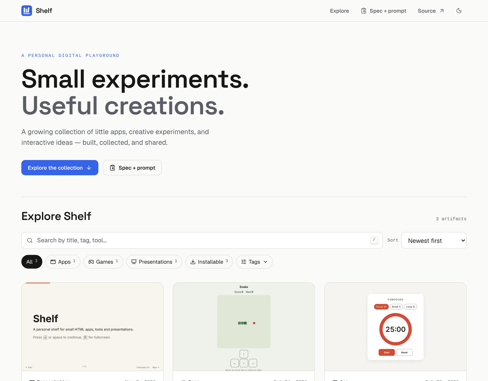
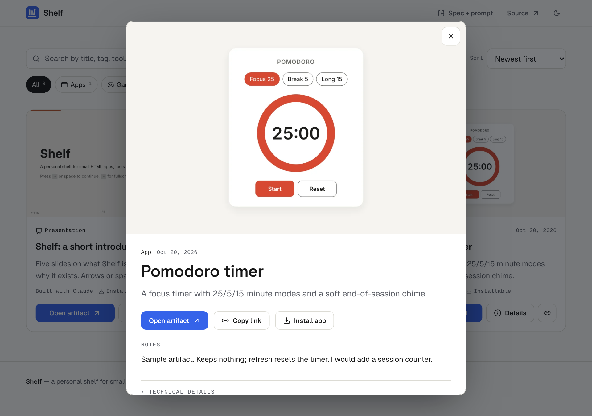
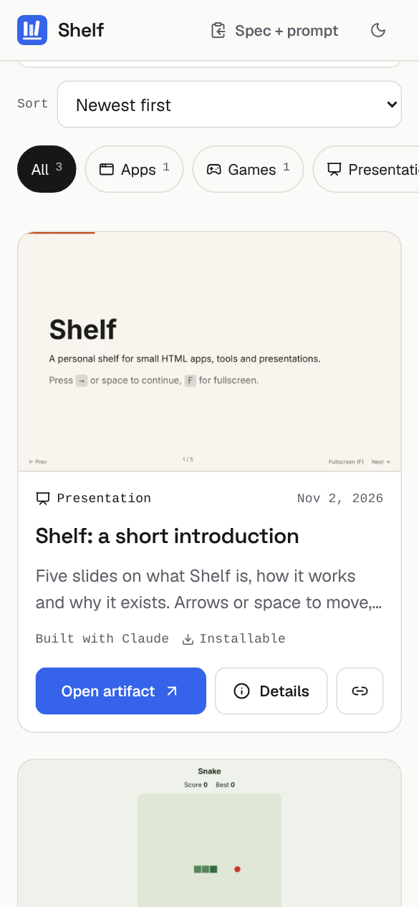
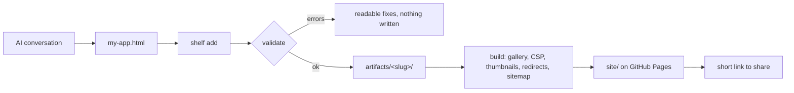

<div align="center">

# Shelf

**A permanent home for the small things you make with AI.**
Apps, games, slide decks and experiments, kept in one repo, checked against a spec, and published as a fast, searchable gallery you can share by link.

[**Live site →**](https://ariffurrhmn.github.io/shelf/)



</div>

---

## Why it exists

I make a lot of small things in conversations with Claude and ChatGPT: a one-page calculator, a throwaway game, a deck for a talk. Each one is a single HTML file that comes out of a chat window, and then it is scattered across chat history, downloads folders and preview panes. A few weeks later I cannot find it, and on another machine I am out of luck.

Shelf gives each of them a permanent, organised, good-looking home, reachable by a short link, and makes getting a new one in take about a minute.

It is a personal project, built for one author. It is not a platform: no accounts, no database, no server.

## What you get

- **A gallery worth showing off.** Editorial design, light and dark themes, image-first cards, featured artifacts, and a details view with the why, the notes and the technical facts.
- **Fast discovery.** Search (press `/`), category, tag and "installable" filters, four sort orders, shareable filtered URLs.
- **Publishing in one command.** `python shelf add my-app.html` validates, names, files and describes an artifact, with nothing half-written if it fails.
- **Short, permanent links.** Every artifact lives at a 4-character address like `…/shelf/74ng` (add `#3` for slide 3). Renamed artifacts keep their old addresses, and a CI check fails if a published link would stop working.
- **A one-click brief for any AI.** The **Spec + prompt** button copies the prompt, the full spec and the metadata reference, ready to paste into Claude or ChatGPT.
- **Sharing that looks right.** Open Graph and Twitter cards on every artifact address, a social preview image, sitemap and robots.
- **Installable apps.** Mark an artifact `install: true` and it becomes an offline app on desktop or phone.
- **Safer by default.** A browser-enforced network policy per artifact, secret scanning, request-limited screenshots, least-privilege CI. See [Security](#security-and-its-limits) for what is *not* covered.

<p align="center">
  
  
</p>

## Quick start

Requires Python 3.9+ (standard library only). Node 18+ is needed to build the gallery and make thumbnails.

```bash
git clone https://github.com/ariffurrhmn/shelf && cd shelf
(cd gallery && npm ci)                 # once
python shelf doctor                    # checks your setup
python shelf preview                   # builds the site and serves http://127.0.0.1:8000/shelf/
```

### Add a creation

Three ways, from least to most setup. All of them validate first and never publish by themselves.

**1. From the clipboard** (at your computer). Press **Spec + prompt** on the site and paste it into Claude or ChatGPT before you ask for the app. When the reply arrives, click Copy on its code block, then:

```bash
python shelf add --clipboard           # keeps just the HTML, validates, asks "Add it?"
python shelf preview <slug>            # see it in the real gallery
python shelf add --clipboard --yes --push   # or: no questions, commit and push (to main this deploys)
```

**2. From a file.** `python shelf add my-app.html` (or a folder with an `index.html`), then commit and push yourself.

**3. From GitHub, without cloning** (works on a phone). Put the HTML in `inbox/`: on the repo page choose *Add file → Create new file*, name it `inbox/anything.html`, paste, and choose *create a new branch and start a pull request*. A workflow turns it into an artifact on that PR and comments with the result; merge to publish. Name the file after an existing artifact (`focus-timer.html`) to update it. Details and a caveat about secrets: [`inbox/README.md`](inbox/README.md).

Non-interactive (scripts, CI):

```bash
python shelf add my-app.html --yes --title "Focus Timer" --category app \
  --tags productivity,timer --tool claude --description "A 25-minute focus timer."
```

The full walkthrough, all flags and troubleshooting are in [`docs/ai-workflow.md`](docs/ai-workflow.md).

## Commands

| Command | What it does |
| --- | --- |
| `shelf add <file\|folder\|->` / `--clipboard` | Import HTML as a new artifact. `--dry-run`, `--fix`, `--force`, `--thumbnail`, `--commit`, `--push`, metadata flags. |
| `shelf ingest` | Turn the files in `inbox/` into artifacts (what the inbox workflow runs). |
| `shelf validate [slug…]` | Check against the spec. `--strict` fails on warnings; `--json` for tools. |
| `shelf list` | The collection at a glance (`--json`). |
| `shelf preview [slug]` | Build and serve under `/shelf/` like GitHub Pages. `--raw` serves `artifacts/` instantly. |
| `shelf rename <old> <new>` | Rename without breaking the old address or short link. |
| `shelf links [--compare REF]` | List short links; check nothing published at `REF` disappeared (intentional removals go in `retired.json`). |
| `shelf doctor` | Check Python, Node, dependencies, artifacts and link plan. |
| `shelf prompt [--full]` | Print the instructions for an AI assistant (`--full` adds the spec and metadata reference, like the site's button). |

`shelf` never pushes or deploys. Publishing is a `git push` you do yourself.

## Artifact metadata

Each artifact is `artifacts/<slug>/index.html` with a JSON block in `<head>`. Five fields are required; everything else is optional, so older artifacts keep working.

```html
<script type="application/json" id="shelf-meta">
{
  "title": "Focus Timer",
  "description": "A 25-minute focus timer with a soft chime.",
  "created": "2026-10-20",
  "tool": "Claude",
  "kind": "app",

  "tags": ["productivity", "timer"],
  "status": "finished",
  "why": "I kept losing track of my breaks.",
  "featured": true,
  "storage": "local",
  "network": [],
  "install": true
}
</script>
```

| Field | Notes |
| --- | --- |
| `title`, `description`, `created`, `tool`, `kind` | Required. `kind` is the category: `app`, `game`, `presentation`, `doc`, `other`. |
| `tags`, `status`, `why`, `notes`, `featured`, `updated`, `source` | Optional presentation fields. Nothing is featured unless you say so. |
| `storage`, `network` | What the artifact uses. **Declare it honestly: the browser enforces `network`.** |
| `install`, `color` | Installable offline app. |
| `thumbnail` | Your own cover image (file in the folder) instead of the automatic screenshot. |
| `short`, `aliases` | Your own short-link code; earlier slugs that must keep working. |
| `draft` | Keep it off the public site (it is still in the public repo). |

Complete reference with limits and an example: [`spec/METADATA.md`](spec/METADATA.md). Rules: [`spec/SPEC.md`](spec/SPEC.md).

## How it works



```text
shelf/
├── artifacts/   One folder per artifact
├── shelf        The CLI launcher (python shelf …)
├── links.json   Extra short links: "code": "https://..."
├── spec/        Spec, metadata reference, paste-in AI prompt
├── gallery/     The UI (Vite, React, Tailwind) with its tests
├── tools/       cli/ validate/ build/ (Python, plus Node for thumbnails and e2e)
├── docs/        Architecture, decisions, security, deployment, AI workflow, roadmap
└── .github/     The test, build and deploy workflow
```

Architecture notes: [`docs/architecture.md`](docs/architecture.md). Decisions and trade-offs: [`docs/decisions.md`](docs/decisions.md).

## Thumbnails

The build screenshots every artifact in headless Chromium (1280×800 WebP plus a 640 px copy), after the page has loaded, fonts are ready and the picture has stopped changing. Requests outside the artifact's declared hosts are blocked, blank captures are rejected, and results are cached by content so unchanged artifacts are not re-rendered.

Limits: an app that needs a click, a login or an undeclared network call shows its starting state or a placeholder. Give those a `thumbnail` image (`shelf add … --thumbnail shot.png`). Locally you need `cd tools/build && npm ci && npx playwright install chromium` (or set `SHELF_CHROMIUM`); without them the gallery shows placeholders and everything else still works.

## Tests

```bash
python -m unittest discover -s tools/validate/tests    # validator and metadata schema
python -m unittest discover -s tools/build/tests       # build, CSP, SEO, aliases, short links
python -m unittest discover -s tools/cli/tests         # CLI behaviour and safety
(cd gallery && npm run typecheck && npm test)          # types; search, filter, sort, URL logic
python tools/build/build.py --no-thumbnails            # production build
(cd tools/build && npm ci && npm run e2e)              # browser tests against site/
```

## Deploying

A push to `main` runs the tests, validates, builds and publishes to GitHub Pages. Set **Settings → Pages → Source** to **GitHub Actions** once. A custom domain or a short domain for shorter links is one repository variable (`SHELF_CNAME`). Details: [`docs/deployment.md`](docs/deployment.md).

## Security and its limits

Shelf scans for secrets, requires artifacts to declare storage and network use, and then **enforces the declared network list in the browser** with a Content-Security-Policy on every served artifact. Screenshots run with a request allowlist, and CI has read-only permissions and no secrets.

What this does **not** do: all artifacts are served from one origin, so a hostile artifact could read another artifact's browser storage or redirect the page. Treat Shelf as *trusted publishing*: publish what you wrote or have read. Isolating untrusted artifacts needs a separate origin, which is documented but not built. The full model, what is and is not protected, and safe iframe embedding: [`docs/security.md`](docs/security.md).

## Accessibility and performance

Built toward WCAG 2.2 AA: colour tokens are contrast-checked in both themes (`gallery/scripts/check-contrast.mjs`), full keyboard use, a skip link, one visible focus style, focus-trapped dialog that returns focus to the button that opened it, reduced-motion support, 44 px touch targets on touch screens, and screen-reader announcements for result counts and copied links. This has been tested with automated browser checks, not with a screen reader or a formal audit.

Measured on the built site in headless Chromium (no throttling): gallery JS 94 KB gzip, CSS 7 KB gzip, two self-hosted font files (51 KB), thumbnails 5–15 KB each, layout shift 0.002–0.007, first contentful paint about 150–180 ms. Filtering 500 artifacts re-renders in about 200 ms. Numbers on real devices and networks will differ.

## Troubleshooting

| Problem | Try |
| --- | --- |
| Gallery says it could not load the list | Serve over HTTP (`python shelf preview`); opening `index.html` from disk cannot fetch `artifacts.json`. |
| `shelf add` rejects a file | Read the hints under the errors; `--fix` repairs missing `lang`/viewport; `--storage local` and `--network …` declare usage. |
| Thumbnails are placeholders | Run `python shelf doctor`; install Playwright's Chromium (see Thumbnails). Add a `thumbnail` for pages that need interaction. |
| A short link clashes | The build names both owners; set `short` on one artifact. Codes are never renumbered silently. |
| Preview port busy | `python shelf preview --port 8001`. |
| An old link 404s after a rename | Use `python shelf rename`; `python shelf links --compare origin/main` shows what broke. |

## Roadmap

See [`docs/roadmap.md`](docs/roadmap.md). Next: turn on Pages, add real artifacts (see [`docs/collection.md`](docs/collection.md)), choose a final domain.

## Repository About and topics

Suggested text and topics are in [`docs/collection.md`](docs/collection.md#repository-about-and-topics).
