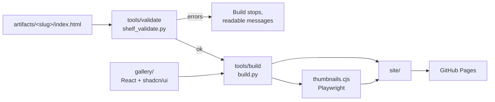

# Architecture

Shelf is a spec, a validator and a build step that turn a folder of HTML files into a static site.



## Pieces

| Piece | Path | Role |
| --- | --- | --- |
| Spec | `spec/` | Rules, metadata reference and the paste-in prompt. |
| Validator | `tools/validate/shelf_validate.py` | Checks one or all artifacts. Standard library only. Exit code 1 on errors. |
| Build script | `tools/build/build.py` | Validates, builds the gallery, copies non-draft artifacts, makes thumbnails, writes `artifacts.json`. |
| Short links | `tools/build/shortlinks.py` | Picks a short code per artifact, reads `links.json`, writes one redirect page per code. Also a CLI: `python tools/build/shortlinks.py [slug]`. |
| Thumbnails | `tools/build/thumbnails.cjs` | Screenshots each artifact to `site/thumbnails/<slug>.jpg`. Optional. |
| Gallery | `gallery/` | Vite + React + Tailwind v4 + shadcn/ui. Reads `artifacts.json`, shows search, filters and details. |
| Deploy | `.github/workflows/deploy.yml` | Tests, builds on every push, and deploys to Pages from `main`. |

## Output layout (`site/`)

```text
site/
├── index.html, assets/      gallery UI
├── artifacts.json           manifest the gallery reads
├── artifacts/<slug>/        copied artifact folders (drafts excluded)
├── <code>/index.html        one redirect page per short link
├── thumbnails/<slug>.jpg    optional
└── .nojekyll, CNAME?
```

## Manifest (`artifacts.json`)

`{ generated, repo?, artifacts: [ { slug, title, description, created, tool, kind, tags, storage, network, notes, url, short, thumbnail } ] }`, sorted newest first. All URLs are relative.

## Short links

Static hosting cannot answer a request with a redirect, so each short link is a folder with a tiny `index.html`. It sends the visitor on with JavaScript (carrying `?query` and `#hash`, so `/pdhh#4` opens slide 4) and has a `<meta http-equiv="refresh">` inside `<noscript>` as a fallback. Targets of artifact links are relative (`../artifacts/<slug>/`), so they work from any host or sub-path. The page is served as `/<code>/` after the host adds the slash, and the script also works if the host serves it at `/<code>`.

The plan is made right after validation and before the slow gallery build, so a code clash fails the build in seconds. The redirect pages are written after the gallery build, which empties `site/`.

## Boundaries

- Artifacts are served as they are. The gallery links to them; it does not embed them.
- The gallery needs only the manifest, so any static host works.
