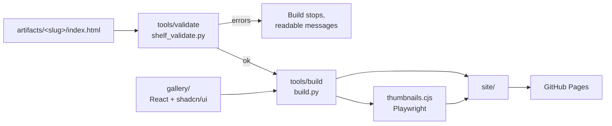
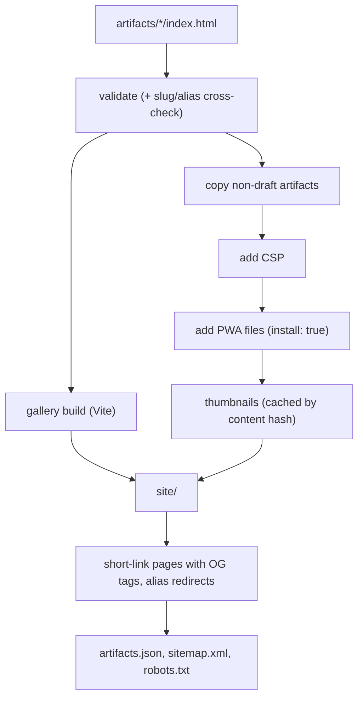

# Architecture

Shelf is a spec, a validator and a build step that turn a folder of HTML files into a static site.



## Pieces

| Piece | Path | Role |
| --- | --- | --- |
| Spec | `spec/` | Rules, metadata reference and the paste-in prompt. |
| CLI | `shelf`, `tools/cli/shelf_cli.py` | `add`, `validate`, `list`, `preview`, `rename`, `links`, `doctor`, `prompt`. Standard library only. |
| Validator | `tools/validate/shelf_validate.py` | Checks one or all artifacts, plus slug/alias collisions. Exit code 1 on errors. |
| Build script | `tools/build/build.py` | Orchestrates the build (below). |
| Hardening | `tools/build/harden.py` | Injects a Content-Security-Policy that enforces each artifact's declared network. |
| SEO | `tools/build/seo.py` | `robots.txt`, `sitemap.xml`, Open Graph/Twitter tags, canonical URLs, gallery CSP. |
| Short links | `tools/build/shortlinks.py` | Picks a short code per artifact, reads `links.json`, writes redirect pages (with share tags) and alias redirects. |
| Thumbnails | `tools/build/thumbnails.cjs` | Captures 1280×800 and 640×400 WebP per artifact in a request-allowlisted headless browser, cached by content hash. |
| PWA step | `tools/build/pwa.py` | For `install: true`: manifest, icons, service worker, injected tags. |
| Gallery | `gallery/` | Vite + React + Tailwind v4. Reads `artifacts.json`. See `gallery/README.md`. |
| E2E tests | `tools/build/e2e/` | Playwright against the built site, served under `/shelf/`. |
| Deploy | `.github/workflows/deploy.yml` | Tests, builds, checks permanent links, deploys `main` to Pages. |

## Build pipeline



## Output layout (`site/`)

```text
site/
├── index.html, assets/, favicon.svg, og.png, 404.html    gallery
├── artifacts.json           manifest the gallery reads
├── robots.txt, sitemap.xml
├── artifacts/<slug>/        copied artifact folders (drafts excluded), with a CSP tag
│   └── manifest.webmanifest, icon-*.png, sw.js   only when install: true
├── artifacts/<old-slug>/    redirect page for every alias
├── <code>/index.html        one redirect + share-card page per short link
├── thumbnails/<slug>-<hash>.webp, …-640.webp
└── .nojekyll, CNAME?
```

## Manifest (`artifacts.json`)

`{ generated, repo?, artifacts: [ … ] }`, sorted newest first by `created`. Each entry: `slug, title, description, created, tool, kind, tags, storage, network, notes, why, status, featured, updated, source, aliases, url, short, thumbnail, thumbnailSmall, thumbnailWidth, thumbnailHeight, install, icon, color`. Optional fields are `null`/empty when unset. All URLs are relative, so the site works at the domain root or under a sub-path.

## Short links

Static hosting cannot answer a request with a redirect, so each short link is a folder with a tiny `index.html`. It sends the visitor on with JavaScript (carrying `?query` and `#hash`, so `/pdhh#4` opens slide 4) and has a `<meta http-equiv="refresh">` inside `<noscript>` as a fallback. The page also carries Open Graph and Twitter tags for its artifact (crawlers do not run JavaScript, so this is how a shared short link gets a title, description and thumbnail card). Targets of artifact links are relative (`../artifacts/<slug>/`), so they work from any host or sub-path. The page is served as `/<code>/` after the host adds the slash, and the script also works if the host serves it at `/<code>`.

The plan is made right after validation and before the slow gallery build, so a code clash fails the build in seconds. The redirect pages are written after the gallery build, which empties `site/`.
`
## Boundaries

- Artifacts are served as they are, except the CSP tag, and the PWA files and tags when `install: true`. The gallery links to them; it does not embed them (see [security.md](security.md)).
- The gallery needs only the manifest, so any static host works.
- Per-project social previews are static: the short-link page for each artifact has the tags. The `#slug` view inside the gallery cannot (crawlers ignore client-side meta changes), so share short links.
